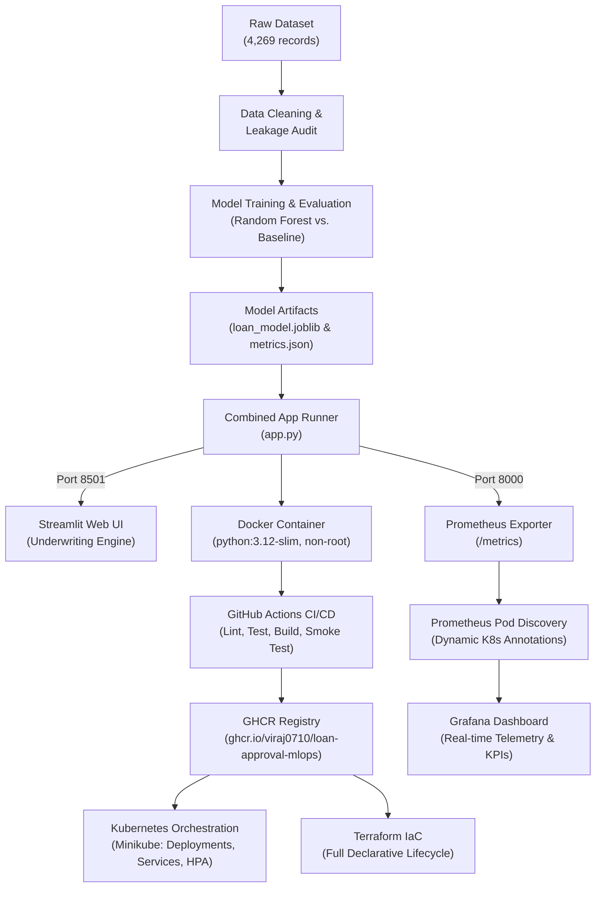

# 🏦 LoanGuard AI — End-to-End MLOps Loan Approval Prediction Platform

[](https://github.com/viraj0710/loan-approval-mlops/actions/workflows/ci-cd.yml)
[](https://github.com/viraj0710/loan-approval-mlops/pkgs/container/loan-approval-mlops)
[](https://www.python.org/)
[](https://opensource.org/licenses/MIT)
[](https://share.streamlit.io/)

A complete, production-grade **Machine Learning Operations (MLOps)** system for automated loan eligibility underwriting. The platform combines scikit-learn predictive pipelines, automated validation with data leakage audits, a dual-port containerized Streamlit application, full Kubernetes orchestration with Horizontal Pod Autoscaling (HPA), Terraform Infrastructure as Code (IaC), and continuous telemetry with Prometheus and Grafana.

---

## 🏛️ System Architecture



---

## 📊 Model Performance & Leakage Audit

Two algorithms were trained and cross-validated using an 80/20 train-test split:
- **Baseline Model:** Logistic Regression (L-BFGS, standard scaler)
- **Champion Model:** Random Forest Classifier (100 estimators, balanced class weights)

| Evaluation Metric | Logistic Regression (Baseline) | Random Forest (Champion) | Delta |
| :--- | :--- | :--- | :--- |
| **Accuracy** | 92.27% | **97.78%** | +5.51% |
| **Precision** | 92.66% | **97.58%** | +4.92% |
| **Recall** | 95.10% | **98.87%** | +3.77% |
| **F1 Score** | 93.87% | **98.22%** | +4.35% |
| **ROC AUC** | 97.45% | **99.64%** | +2.19% |

### 🔍 Synthetic Data Leakage Audit
In exploratory data analysis and feature importance analysis, `cibil_score` was identified as having an ~0.77 correlation with `loan_status` (accounting for 84.6% of Random Forest feature importance). In synthetic Kaggle datasets, scores $\ge 550$ correlate strongly with approval. In production banking environments, this baseline threshold is combined with strict debt-to-income and asset coverage underwriting rules, both of which are computed and displayed live in the application UI.

---

## ⚡ Quick Start (Local Development)

### 1. Clone Repository & Setup Virtual Environment
```bash
git clone https://github.com/viraj0710/loan-approval-mlops.git
cd loan-approval-mlops

python -m venv .venv
source .venv/bin/activate  # On Windows: .venv\Scripts\activate
pip install -r requirements-dev.txt
```

### 2. Run Tests & Linting
```bash
# Run flake8 linter
flake8 app.py src tests streamlit_app.py scripts

# Run full pytest test suite (14 tests)
pytest tests/
```

### 3. Launch Application & Prometheus Exporter
```bash
python app.py
```
- **Streamlit Web UI:** [http://localhost:8501](http://localhost:8501)
- **Prometheus Metrics:** [http://localhost:8000/metrics](http://localhost:8000/metrics)
- **Container Health Check:** [http://localhost:8501/_stcore/health](http://localhost:8501/_stcore/health)

---

## 🐳 Docker Containerization

The production container runs under an unprivileged user (`appuser`, UID `10001`) with multi-port exposure and a built-in health check:

```bash
# Build the container image
docker build -t loan-approval-mlops:latest .

# Run container exposing both UI (8501) and Prometheus metrics (8000)
docker run -d --name loan-app -p 8501:8501 -p 8000:8000 loan-approval-mlops:latest

# Verify health status
docker ps -f name=loan-app
curl http://localhost:8501/_stcore/health
curl http://localhost:8000/metrics
```

---

## ☸️ Kubernetes (Minikube) Deployment

Kubernetes manifests are located in `k8s/`:
- `k8s/namespace.yaml` — `loan-app` isolated namespace
- `k8s/deployment.yaml` — 2 replicas, rolling updates, health & readiness probes, Prometheus annotations
- `k8s/service.yaml` — Dual-port NodePort service (`8501:30501`, `8000:30800`)
- `k8s/hpa.yaml` — Horizontal Pod Autoscaler (2–5 replicas, 75% CPU threshold)

```bash
# Load local image into Minikube
minikube image load loan-approval-mlops:latest

# Deploy with Kustomize
kubectl apply -k k8s/

# Verify pods and service
kubectl get pods -n loan-app
kubectl get svc -n loan-app

# Access service in Minikube
minikube service loan-approval-service -n loan-app
```

---

## 🏗️ Infrastructure as Code with Terraform

Terraform declarations in `terraform/` manage the entire Kubernetes deployment lifecycle:

```bash
cd terraform

# Initialize provider plugins (hashicorp/kubernetes)
terraform init

# Plan changes
terraform plan

# Apply infrastructure (creates namespace loan-app-tf, deployment, service, HPA)
terraform apply -auto-approve

# Destroy and recreate lifecycle
terraform destroy -auto-approve
terraform apply -auto-approve
```

---

## 📈 Monitoring with Prometheus & Grafana

The monitoring stack resides in `monitoring/`:
- **Prometheus:** Auto-discovers all pods annotated with `prometheus.io/scrape: "true"` across namespaces.
- **Grafana:** Automatically provisions the Prometheus datasource and imports the pre-built `loan-approval-dashboard.json`.

```bash
# Deploy monitoring stack
kubectl apply -f monitoring/namespace.yaml
kubectl apply -f monitoring/prometheus/rbac.yaml
kubectl apply -f monitoring/prometheus/prometheus-configmap.yaml
kubectl apply -f monitoring/prometheus/prometheus-deployment.yaml
kubectl create configmap grafana-loan-dashboard -n monitoring \
  --from-file=loan-approval-dashboard.json=monitoring/grafana/dashboards/loan-approval-dashboard.json
kubectl apply -f monitoring/grafana/grafana-deployment.yaml

# Access Prometheus & Grafana
minikube service prometheus-service -n monitoring  # Port 30090
minikube service grafana-service -n monitoring     # Port 30300 (admin / admin)
```

### Metrics Tracked
| Metric Name | Type | Description |
| :--- | :--- | :--- |
| `loan_predictions_total` | Counter | Total inferences partitioned by outcome (`Approved`, `Rejected`) and model version |
| `loan_prediction_latency_seconds` | Histogram | Inference execution duration in seconds |
| `loan_approval_probability` | Histogram | Distribution of predicted approval probabilities (0.0 – 1.0) |
| `loan_applicant_cibil_score` | Histogram | Applicant credit scores (300 – 900) |
| `loan_requested_amount_inr` | Histogram | Principal loan amounts requested |
| `loan_app_requests_total` | Counter | Streamlit page visits and user actions |
| `loan_model_info` | Info | Deployed model specifications, accuracy, and F1 score |

---

## ☁️ Public Deployment (Streamlit Community Cloud)

To deploy the application live to the web in one click:
1. Log in to [share.streamlit.io](https://share.streamlit.io/) with your GitHub account (`viraj0710`).
2. Click **New app**.
3. Select:
   - **Repository:** `viraj0710/loan-approval-mlops`
   - **Branch:** `main`
   - **Main file path:** `streamlit_app.py`
4. Click **Deploy!**

---

## 📜 Verification Tracking

Every phase and deliverable in this project is verified with reproducible evidence in [docs/VERIFICATION.md](docs/VERIFICATION.md).
